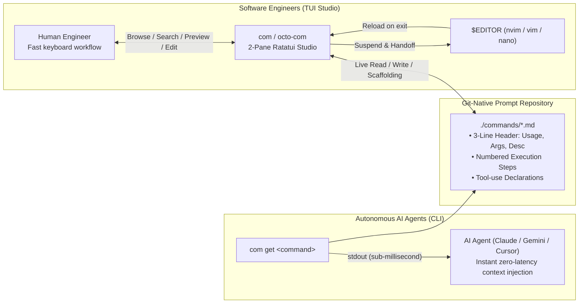

# octo-com 🐙

<p align="center">
  <strong>The zero-bloat runbook & reusable prompt engine for AI agents and human engineers.</strong><br>
  <em>Extracted and elevated from <a href="https://github.com/octopus-harness/octopus">Octopus Harness</a> into a blazing fast, standalone Rust CLI and Ratatui TUI studio.</em>
</p>

<p align="center">
  <a href="https://www.rust-lang.org"></a>
  <a href="https://ratatui.rs"></a>
  <a href="https://github.com/crossterm-rs/crossterm"></a>
  
  
  <a href="https://github.com/octopus-harness/octopus"></a>
  <a href="https://opensource.org/licenses/MIT"></a>
</p>

---

## ⚡ The Zero-Bloat Philosophy

Modern AI workflows frequently suffer from **prompt management bloat**: heavy Python dependency trees, proprietary cloud registries, opaque vector databases, and multi-second SDK latencies just to fetch a prompt template.

**`octo-com` rejects that complexity.**

Reusable prompts and agent runbooks are simply **Markdown files stored directly in Git**. They should be blazingly fast to query for automated agents, instantly searchable, and effortlessly curated by humans in their native terminal environment.

| Dimension | Heavy Prompt Platforms / Frameworks | `octo-com` |
| :--- | :--- | :--- |
| **Storage & Sync** | Proprietary DB, SaaS vendor lock-in | Pure Git repository (`./commands/*.md`) |
| **Agent Retrieval** | Multi-second Python/Node API call | Sub-millisecond binary (`com get <name>`) |
| **Human Experience** | Clunky browser dashboards | Keyboard-driven Ratatui TUI with live GFM preview |
| **Portability** | Trapped in proprietary ecosystem | Works across any agent, script, or editor |
| **Runtime Footprint** | Hundreds of MBs of virtualenvs & deps | Single self-contained native binary (~5MB) |
| **Auditability** | Separate logs and cloud audit trails | Plain `git log`, `git diff`, and pull requests |

### 🐙 Origin: Extracted from Octopus Harness

`octo-com` originates from [**Octopus**](https://github.com/octopus-harness/octopus), an autonomous agent harness that popularized the convention of storing executable prompts as `$$<command>` Markdown runbooks in a repository's `commands/` directory.

In Octopus, agents invoke the [`bin/com`](https://github.com/octopus-harness/octopus/blob/main/bin/com) script on demand to load specialized instructions and workflows into their prompt context.

`octo-com` extracts and completely redesigns that utility in **Rust**:
1. **Preserves 100% backward compatibility** with the Octopus `com` protocol.
2. **Elevates the developer experience** by bundling both a headless, zero-overhead CLI (`com`) and a rich, keyboard-driven Ratatui terminal studio (`octo-com`).
3. **Decouples from the harness**, allowing any engineering team or autonomous agent to manage reusable prompt libraries anywhere on their system.

---

## 🏗️ Architecture & Dual-Persona Workflow

`octo-com` bridges the gap between **autonomous AI agents** (who need instant stdout prompt injection) and **human developers** (who write, review, and maintain prompt runbooks):



---

## 🖥️ Interactive TUI Studio

Launch the full-screen terminal studio with `com` or `octo-com`:

```
┌─── 🐙 OCTO-COM ─── [Dir: /workspace/commands] ──── [24 Commands | 24 Valid | 98 Steps] ──── [Preview (GFM)] ───┐
│ [1] Commands ─────────────────────────────│ [2] Command Detail [Preview (GFM)] ────────────────────────────────│
│  > $$content_prompt         [2 steps]     │ ╭─ $$content_prompt (content_prompt.md) ─────────────────────────╮ │
│    $$deep_spec              [4 steps]     │ │ [✓ Valid Header]   2 steps   78 words   18 lines   642 B           │ │
│    $$doctor                 [3 steps]     │ │ Usage:       $$content_prompt [topic]                          │ │
│    $$refactor_clean         [5 steps]     │ │ Args:        [topic]                                           │ │
│    $$review_pr              [3 steps]     │ │ Description: Pull todos from doer and draft technical article   │ │
│    $$test_coverage          [2 steps]     │ ╰────────────────────────────────────────────────────────────────╯ │
│                                           │ Tool use is allowed for this command.                              │
│                                           │                                                                    │
│                                           │ 1. Pull active tasks from doer MCP server for topic.               │
│                                           │ 2. Synthesize context into devbook outline.                        │
│                                           │ 3. Generate high-signal article draft in markdown.                 │
│                                           │                                                                    │
└─ [1/2] Focus  [j/k] Move  [v] Raw/Preview  [n] New  [e] Edit  [a] Append  [E] $EDITOR  [/] Search  [?] Help ────┘
```

### Studio Capabilities
- **2-Pane Master–Detail Layout**: Effortlessly navigate your prompt library with Vi-style keys (`j`/`k`, `Tab`, `1`/`2`).
- **Dual View Modes (`v` / `m`)**: Instantly toggle between **Styled GFM Preview** (rendered headers, code badges, step counters) and **Raw Line-Numbered Markdown**.
- **Header Scaffolding (`n`)**: Generate new command files pre-populated with standard Octopus headers in seconds.
- **In-App Editing & Renaming (`e`)**: Update command metadata or rename files in place without touching disk manually.
- **Quick-Append Steps (`a`)**: Append the next numbered step (`N. ...`) right from the TUI.
- **Seamless `$EDITOR` Handoff (`E`)**: Suspends the terminal studio cleanly, launches `$EDITOR` (`nvim`, `vim`, `nano`), and automatically reloads modifications on exit.
- **Instant Search (`/`)**: Live fuzzy filtering across prompt titles, argument specs, descriptions, and file contents.
- **Clipboard Integration (`y` / `c`)**: Copy the `$$command` invocation or full raw markdown content straight to your system clipboard.

---

## 📋 The Octopus `$$` Runbook Specification

Every reusable prompt in `commands/<name>.md` conforms to a standardized 4-line metadata header (with backward-compatible support for legacy 3-line headers), followed by instructions optimized for LLM comprehension:

```markdown
Usage: $$<name> [args]
Args: <args or "-">
Description: <one-line summary of capability>
Category: <category or "-">

Tool use is allowed for this command.

1. Step one instructions...
2. Step two instructions...
3. Verification criteria...
```

- **Prefix-agnostic**: Run `com get my_prompt` or `com get '$$my_prompt'`—`octo-com` resolves both seamlessly.
- **Auto-Validation**: The TUI automatically validates headers and flags missing fields with an alert tag.
- **Backward Compatible**: Existing 3-line headers without a `Category:` field are fully supported and display as `Uncategorized`.

---

## 🚀 Command-Line Interface (CLI)

`octo-com` installs both `com` (matching Octopus conventions) and `octo-com`.

### Prompt Retrieval for Agents
```bash
# Agents query prompts instantly via stdout
com get content_prompt

# Supports leading $$ and .md extension automatically
com get '$$content_prompt'
com get deep_spec.md
```

### Prompt Authoring & Management
```bash
# List all commands in an aligned summary table (COMMAND, CATEGORY, ARGS, DESCRIPTION)
com list

# Filter commands by category
com list --category dev
com list -c ops

# Scaffold a new command with valid 4-line header
com add deep_spec --category dev --args "[feature]" --desc "Synthesize issues into an actionable spec"

# Create a blank markdown command
com add scratch --blank

# Open command directly in your editor
com edit deep_spec

# Delete a command
com rm scratch
```

### Global Configuration & Resolution Hierarchy
Run `com` anywhere in your terminal without needing to be inside the repository root:

```bash
# Set a persistent global commands directory (stored in ~/.config/octo-com/config.json)
com config set-dir ~/src/my-project/commands

# Inspect active configuration
com config get-dir
com config
```

#### Directory Resolution Priority
1. `--dir <path>` / `-dir <path>` / `-d <path>` command-line flags
2. `OCTO_COMMANDS_DIR` environment variable
3. Global configuration in `~/.config/octo-com/config.json`
4. `./commands` in the current working directory (created automatically if missing)

---

## ⚡ Performance & Systems Engineering

`octo-com` is engineered in pure Rust with an uncompromising focus on speed and reliability:

- **Sub-Millisecond Cold Start**: Binary startup and command retrieval run in **< 1ms**, avoiding agent latency penalties during repetitive tool executions.
- **Zero Heavy Runtime**: No Node.js runtime, no Python interpreter, no dynamic JVM overhead. Compiles to a single lightweight static binary (~5MB).
- **Minimal Memory Overhead**: The Ratatui TUI runs in single-digit megabytes of RAM with high-performance double-buffering via Crossterm.
- **Clean Terminal Suspension**: External editor invocation cleanly releases terminal raw mode and restores state without screen tearing or cursor artifacts.

---

## ⌨️ TUI Keyboard Reference

| Key | Context | Action |
| :--- | :--- | :--- |
| `1`, `2` | Navigation | Focus Pane 1 (`Commands`) or Pane 2 (`Command Detail`) |
| `Tab` / `h` / `l` | Navigation | Cycle focus between list and detail panes |
| `j` / `k` / `↑` / `↓` | Navigation | Move selection down / up, or scroll detail pane |
| `J` / `K` / `PgDn` / `PgUp`| Navigation | Fast-scroll detail pane |
| `g` / `G` | Navigation | Jump to top / bottom of active view |
| `v` / `m` | View Mode | Toggle between **Preview (GFM)** and **Raw Markdown** |
| `n` | CRUD | **New Command** (scaffolds 3-line header modal) |
| `e` | CRUD | **Edit Header / Rename** command file |
| `a` | CRUD | **Quick Append** numbered step (`N. ...`) |
| `E` | Editor | Open selected command in `$EDITOR` (`nvim`, `vim`, `nano`) |
| `d` | CRUD | **Delete** selected command with confirmation |
| `/` | Search | Live filter across names, arguments, descriptions, and body |
| `y` | Clipboard | Yank `$$<name>` invocation to system clipboard |
| `c` / `Y` | Clipboard | Copy full raw Markdown content to system clipboard |
| `r` | Store | Reload commands directory from disk |
| `?` | Help | Toggle Keyboard Shortcuts modal |
| `q` / `Esc` | General | Clear search filter or quit `octo-com` |

---

## 📦 Installation

### From Source (Cargo)
```bash
# Clone repository
git clone https://github.com/octopus-harness/octo-com.git
cd octo-com

# Build and install to ~/.cargo/bin
cargo install --path .
```

### Rapid Local Development
```bash
# Builds release binary and creates symlinks in /usr/local/bin
./scripts/install-dev.sh
```

---

## 📄 License

Distributed under the [MIT License](https://opensource.org/licenses/MIT).
Originates from [octopus-harness/octopus](https://github.com/octopus-harness/octopus).
